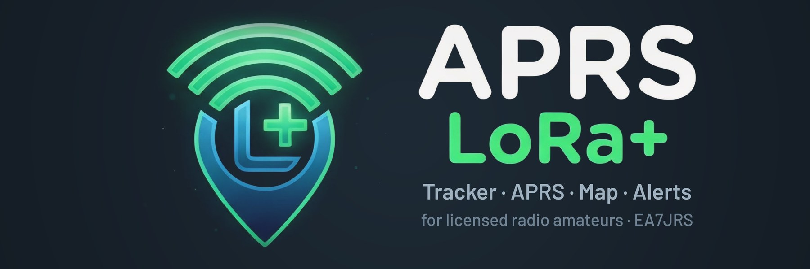
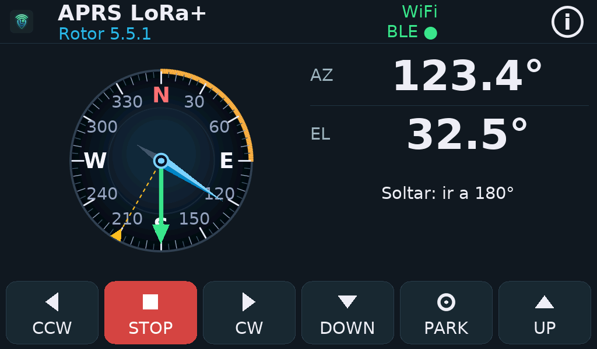
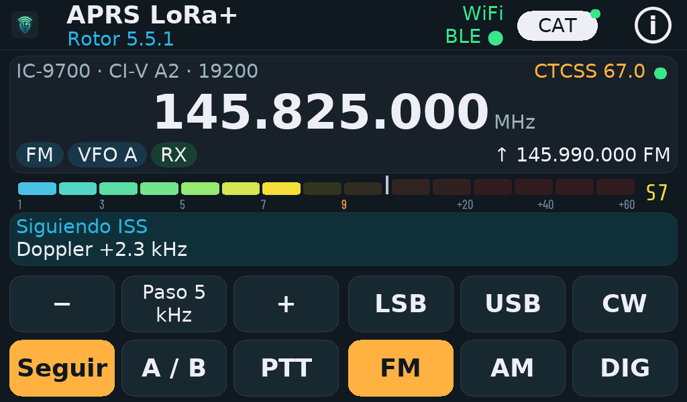
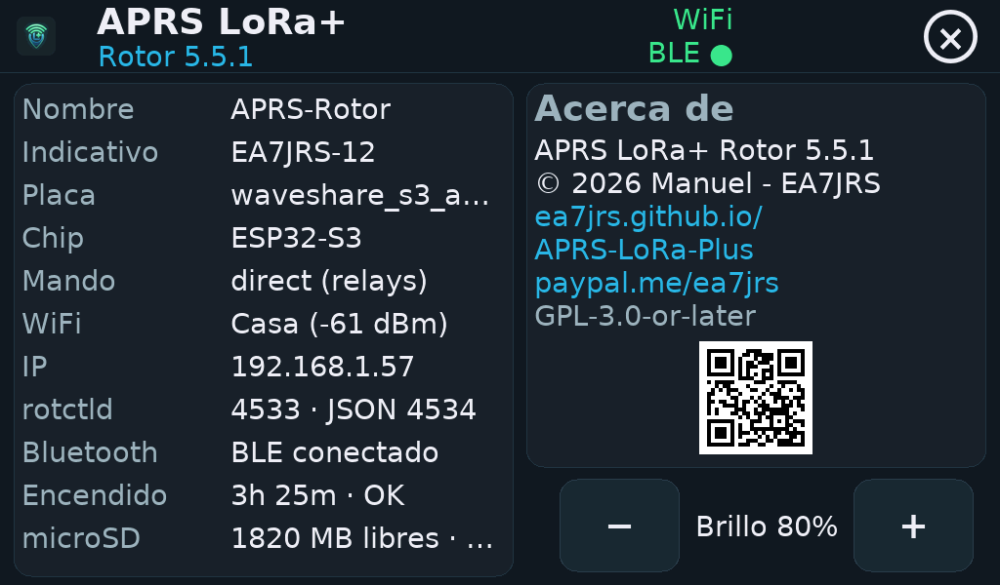
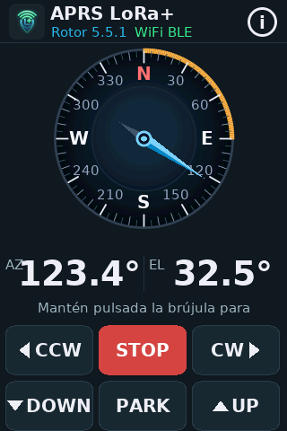

<p align="center"><a href="https://ea7jrs.github.io/APRS-LoRa-Plus/"></a></p>

# APRS LoRa+ Rotor

[](https://paypal.me/ea7jrs)

Controlador de rotores de antena **compatible con Hamlib** para el ecosistema **APRS LoRa+**: lo manejan el [tracker APRS LoRa+](https://github.com/EA7JRS/APRS-LoRa-Plus), la app Android APRS LoRa+ y cualquier programa con Hamlib (GPredict, Look4Sat, PstRotator…).

**Manual**: [español](docs/MANUAL_ES.md) · [English](docs/MANUAL_EN.md) · **Guía rápida / Quick start**: [ES](docs/QUICKSTART_ES.md) · [EN](docs/QUICKSTART_EN.md)

**Placas**: ESP32, ESP32-S3, **Waveshare ESP32-C5-Touch-LCD-3.5**, **ESP32-S3-Touch-AMOLED-2.41**, **ESP32-S3-Touch-LCD-7B** y **ESP32-S3-Touch-LCD-7** (con pantalla táctil: mando del rotor en la propia caja), Raspberry Pi Pico 2 / Pico 2 W y Raspberry Pi (Zero 2 W, 3B / 3B+, 4, 5).

**Esfera** (pantalla táctil y WebUI, la misma que la app, APRS LoRa+ Display y sat-aprs): aguja azul = posición, ámbar = objetivo con su índice en el borde, rojo = topes mecánicos, naranja = solape; en la WebUI la aguja gira por el lado corto.

```
                       ┌──────────────── APRS LoRa+ Rotor ────────────────┐
 Tracker APRS LoRa+ ──►│ rotctld (WiFi 4533)   · GS-232B por SPP           │
                       │ mensajes APRS por LoRa (P az el + TOTP)           │──► rotor
 App Android ─────────►│ BLE / TCP 4534: protocolo JSON (PIN)              │    · control directo (relés / puente H + potenciómetro)
 GPredict, Look4Sat ──►│ rotctld (Hamlib NET rotctl, modelo 2)             │    · pasarela serie (GS-232, Rot2Prog, EasyComm, RS485)
 PC con Hamlib (USB) ─►│ se hace pasar por GS-232A/B, EasyComm II, Rot2Prog│    · Raspberry: rotctld de Hamlib (cualquier modelo) o motores paso a paso
 GPredict, WSJT-X ───►│ rigctld 4532 (CAT)  ──────────────────────────────│──► emisora / SDR (CI-V, Yaesu, Kenwood, SDRconnect)
 Navegador ───────────►│ WebUI (brújula, mando, calibración, config, OTA)  │
                       └───────────────────────────────────────────────────┘
```

## La pantalla táctil

En las placas con pantalla, la caja se maneja desde la propia pantalla: esfera y mando del rotor, CAT de la emisora con Doppler del satélite, e información con el «Acerca de».

| Esfera y mando | Emisora (CAT) con seguimiento Doppler |
|:---:|:---:|
|  |  |
| **Información y «Acerca de»** | **Disposición vertical (LCD 3,5")** |
|  |  |

Capturas de la **versión 5.5.1** generadas en el PC con `firmware/test_host/lcd_preview` (LVGL real); aún sin probar en placa. La misma esfera aparece en la WebUI, la app Android, APRS LoRa+ Display y sat-aprs.

## Qué hace cada placa

| | ESP32 | ESP32-S3 | ESP32-C5 LCD 3,5" | ESP32-S3 AMOLED 2,41" | ESP32-S3 LCD 7" (7B / 7) | Pico 2 W | Pico 2 | Raspberry Pi |
|---|---|---|---|---| --- |---|---|---|
| Control directo (relés / puente H, ADC / ADS1115) | ✔ | ✔ | relés (EXIO8-15) + EXIO_ADC / ADS1115 | ✔ | relés por PCF8574 (I2C) + GPIO6 / ADS1115 (solo la 7B) | ✔ | ✔ | — |
| Mando de otra caja por su rotctld (`driver` 2: p. ej. la pantalla de 7" de una Raspberry Pi con el Stepper HAT) | ✔ | ✔ | ✔ | ✔ | ✔ | ✔ | — | Hamlib modelo 2 (NET rotctl) |
| Pasarela serie a un controlador | ✔ | ✔ | ✔ (U0TXD / U0RXD) | ✔ (TXD / RXD) | ✔ (conector UART) | ✔ | ✔ | ✔ (rotctld de Hamlib: todos los modelos) |
| rotctld por WiFi, JSON por TCP, WebUI | ✔ | ✔ | ✔ (WiFi 2,4 y 5 GHz) | ✔ | ✔ | ✔ | — | ✔ |
| BLE para la app | ✔ | ✔ | ✔ | ✔ | ✔ | pendiente | — | ✔ |
| SPP (GS-232) para el tracker | ✔ | — | — | — | — | ✔ | — | ✔ |
| LoRa APRS | con módulo SX127x / SX126x | con módulo SX127x / SX126x | — | — | — | HAT SX1262 | HAT SX1262 | por TNC KISS |
| Pantalla táctil (mando local; «Acerca de» con el QR del donativo) | — | — | ✔ (vertical) | ✔ (apaisada) | ✔ (7", apaisada) | — | — | — |
| USB como controlador de Hamlib | ✔ | ✔ | ✔ | ✔ | ✔ | ✔ | ✔ | USB gadget (Zero 2 W) |
| CAT de emisora / SDR (CI-V, Yaesu, Kenwood, SDRconnect, rigctl) + rigctld 4532 | ✔ | ✔ | ✔ (UART compartida con la pasarela) | ✔ | ✔ (UART compartida con la pasarela) | ✔ | UART | ✔ (rigctld de Hamlib: todas las emisoras) |
| Red local: viento, posición y rumbo (gpsd, NMEA, Signal K, UDP, OpenWeatherMap) | ✔ | ✔ | ✔ | ✔ | ✔ | — | — | ✔ (`lan.py`) |
| Seguir el sol o la luna (ruido solar, EME), declinación del WMM, fuerza Beaufort | ✔ | ✔ | ✔ | ✔ | ✔ | ✔ | ✔ | ✔ |
| Seguimiento de satélites (SGP4; TLE de CelesTrak / AMSAT, próximo paso, Doppler para el CAT) | — | — | — | — | — | — | — | ✔ (`sat.py`) |
| Enlace punto a punto (apuntar a otra estación: locator, red o baliza APRS) | — | — | — | — | — | — | — | ✔ (`geo.py`) |
| Compensación de actitud (escora / cabeceo / giro del mástil por IMU; orden `att`, tara `att zero`) | ✔ | ✔ | ✔ | ✔ | ✔ | ✔ | ✔ | ✔ (2 y 3 ejes) |
| Hora: GPS de la red y NTP `ntp.roa.es` (ROA) | ✔ | ✔ | ✔ | ✔ | ✔ | NTP | — | NTPsec (NTS del ROA, GPS / PPS de gpsd) |
| Motores paso a paso (Waveshare Stepper Motor HAT, finales de carrera) | — | — | — | — | — | — | — | ✔ |
| Tercer eje (inclinación / cross-level, driver TMC2209) para antenas estabilizadas (domo FB250+); **nivelación automática del balanceo** en móvil (`att.level`) | — | — | — | — | — | — | — | ✔ |
| Perfiles de antena (selector; FB250+ 3 ejes, genérico 2 ejes, propios en `/etc/.../antennas/`) | — | — | — | — | — | — | — | ✔ |
| Calibración: ganancia por dos puntos, cero con la baliza **Inmarsat**, ayuda de los DIP del HAT | — | — | — | — | — | — | — | ✔ |
| **Encoder magnético AS5600** por eje (detecta pasos perdidos; avisa o corrige) | — | — | — | — | — | — | — | ✔ (I²C, mux TCA9548A) |
| **TMC2209 por UART** (corriente, micropasos, StallGuard, **homing sensorless**) | — | — | — | — | — | — | — | ✔ |
| **Modelo de apuntado** multipunto (corrige el desalineado mecánico) + **auto-pico** con el SDR ([docs/POINTING.md](docs/POINTING.md)) | — | — | — | — | — | — | — | ✔ |
| **Radioastronomía** (línea H1): seguir un punto del cielo (RA/Dec o galácticas) y **barrido por deriva** ([docs/RADIOASTRONOMIA.md](docs/RADIOASTRONOMIA.md)) | — | — | — | — | — | — | — | ✔ |
| Antena marina **Sea Tel** por RS422 (`seatel_rotctld`, [docs/SEATEL.md](docs/SEATEL.md)) | — | — | — | — | — | — | — | ✔ (driver hamlib model 2) |
| GS-232 / EasyComm / Rot2Prog por RS485 semidúplex (`serial.rs485`, DE en `serial.de`) | ✔ | ✔ | ✔ | ✔ | ✔ (conector RS485) | ✔ (transceptor automático) | ✔ (transceptor automático) | ✔ (adaptador USB-RS485 + Hamlib) |
| Registro de movimientos en la microSD (`log.sd`, descarga en `/sd`) | — | — | — | — | ✔ | — | — | — |
| GPS propio con PPS y reloj (Uputronics GPS/RTC HAT) | — | — | — | — | — | — | — | ✔ |
| GPS u-blox propio por un conector (NMEA por UART), con filtro de equipo parado y static hold (m8 / m10 / x20) | ✔ | ✔ | ✔ | ✔ | ✔ | — | — | ✔ (Uputronics) |
| Actualización por la WebUI | placas de 8 MB | ✔ | ✔ | ✔ | ✔ | ✔ | — | ✔ (botón «Actualizar software»; o `git pull` + `install.sh`) |

## Versión

Todos los repositorios del proyecto llevan **el mismo número de versión**: el rotor es la **5.5.1**, como el tracker APRS LoRa+. Se publican juntos.

## Instalar

**Instalador web** (Chrome o Edge, placa por USB): https://ea7jrs.github.io/APRS-LoRa-Plus/install/ → elige **Rotor** y tu placa. ESP32, ESP32-S3 y ESP32-C5 se instalan desde el navegador; para la Pico 2 / Pico 2 W descarga el `.uf2` y cópialo a la unidad que aparece al conectarla con BOOTSEL pulsado. El instalador reconoce la placa conectada y su versión (pregunta `APRS-INFO?` por USB).

## Firmware (ESP32, ESP32-S3, ESP32-C5, Pico 2)

PlatformIO (VS Code):

```sh
cd firmware
pio run -e esp32s3 -t upload          # esp32dev · esp32s3 · waveshare_c5_lcd35 · waveshare_s3_amoled241 · waveshare_s3_lcd7b · waveshare_s3_lcd7 · pico2w · pico2
```

En la Pico 2 se puede copiar `firmware.uf2` arrastrándolo con BOOTSEL pulsado. La CI de GitHub compila todas las placas en cada subida y deja los binarios como artefactos.

Primer arranque: abre el punto de acceso **APRS-Rotor** (contraseña `aprsrotor`), entra en `http://192.168.4.1/` (usuario `admin`, contraseña = PIN `123456`) y en *Configuración* pon tu WiFi, tu indicativo, los pines y el tipo de rotor. Cambia el PIN.

## Raspberry Pi

```sh
cd raspberrypi && sudo ./install.sh                     # rotor de Hamlib por su controlador (Pi 3B / 3B+, 4, 5, Zero 2 W: detecta el modelo)
cd raspberrypi && sudo ./install.sh --stepper --gps     # motores paso a paso (Waveshare Stepper Motor HAT) + Uputronics GPS/RTC HAT
cd raspberrypi && sudo ./install.sh --link-uart         # + pantalla LCD-7 / 7B por cable (GPIO8 / 9, GS-232B)
cd raspberrypi && sudo ./install.sh --seatel            # antena Sea Tel por RS422 (seatel_rotctld como rotctld, puerto 4543)
```

La Pi con los HAT se maneja a la vez desde una pantalla LCD-7 / LCD-7B (por WiFi, `driver` 2 contra su rotctld, o por cable) y desde la app por Bluetooth: [Emparejar la Pi](docs/RASPBERRY_HATS.md#emparejar-la-pi-con-una-pantalla-o-con-la-app).

Ver [docs/RASPBERRY_PI.md](docs/RASPBERRY_PI.md) y [docs/RASPBERRY_HATS.md](docs/RASPBERRY_HATS.md) (los dos HAT comparten el GPIO18: hay que mover un cable).

## Documentación

- **Manual de usuario**: [español](docs/MANUAL_ES.md) · [English](docs/MANUAL_EN.md)
- **Guía rápida**: [español](docs/QUICKSTART_ES.md) · [English](docs/QUICKSTART_EN.md)
- [docs/HARDWARE.md](docs/HARDWARE.md): pines, Yaesu G-5500 por el DIN, transistores, divisores, pasarela serie
- [docs/WAVESHARE_C5_LCD35.md](docs/WAVESHARE_C5_LCD35.md): placa con pantalla táctil (conector, relés, potenciómetro, pantalla)
- [docs/WAVESHARE_S3_AMOLED241.md](docs/WAVESHARE_S3_AMOLED241.md): placa con pantalla AMOLED apaisada
- [docs/WAVESHARE_S3_LCD7B.md](docs/WAVESHARE_S3_LCD7B.md): placa con pantalla de 7" (la de APRS LoRa+ Display): relés por PCF8574, potenciómetro en el conector Sensor
- [docs/WAVESHARE_S3_LCD7.md](docs/WAVESHARE_S3_LCD7.md): placa con pantalla de 7" de 800 × 480 (LCD-7 sin B): pasarela de serie o RS485 (también GS-232 / EasyComm / Rot2Prog), registro de movimientos en la microSD, sin placa de relés
- [docs/CAT.md](docs/CAT.md): emisoras (Icom, Yaesu, Kenwood / Elecraft) y receptores SDR (SDRplay RSPdx-R2 con SDRconnect, SDR++, gqrx): conexión, Doppler, CTCSS, PTT, rigctld
- [docs/CONFIG.md](docs/CONFIG.md): todas las opciones de las placas
- [docs/CONTROL_PROTOCOL.md](docs/CONTROL_PROTOCOL.md): protocolo JSON (BLE, TCP, WebUI) para la app
- [docs/APRS_CONTROL.md](docs/APRS_CONTROL.md): mover el rotor con mensajes APRS por LoRa, con código TOTP
- [docs/INTEGRATION.md](docs/INTEGRATION.md): tracker, app, GPredict, Hamlib
- [docs/RASPBERRY_PI.md](docs/RASPBERRY_PI.md): demonio de la Raspberry Pi
- [docs/RASPBERRY_HATS.md](docs/RASPBERRY_HATS.md): Raspberry Pi con el Waveshare Stepper Motor HAT (dos motores paso a paso, encoder AS5600, TMC2209 por UART) y el Uputronics GPS/RTC HAT (posición, PPS, reloj); calibración de ganancia, DIP del HAT, cero con Inmarsat
- [docs/ATTITUDE.md](docs/ATTITUDE.md): compensación de actitud (escora / cabeceo / giro) y nivelación cross-level en plataforma móvil
- [docs/POINTING.md](docs/POINTING.md): modelo de apuntado multipunto (corrige el desalineado mecánico) y auto-pico con el SDR
- [docs/RADIOASTRONOMIA.md](docs/RADIOASTRONOMIA.md): seguir un punto del cielo (línea H1, 1420 MHz) y barrido por deriva
- [docs/SEATEL.md](docs/SEATEL.md): antena marina Sea Tel como rotor del ecosistema (`seatel_rotctld`, RS422, rotctld / LX200)

## Estructura

```
firmware/                    PlatformIO: ESP32, ESP32-S3, ESP32-C5, RP2350
  lib/RotorCore/src/         núcleo en C++ puro (rotctld, GS-232, EasyComm, Rot2Prog, control, APRS, JSON)
  test_host/                 pruebas del núcleo y de la pantalla táctil en el PC (make run)
  src/                       placa, configuración, mando, red, Bluetooth, LoRa, WebUI
raspberrypi/                 demonio en Python (asyncio, sin dependencias salvo dbus-next para Bluetooth)
docs/
```

Pruebas: `make -C firmware/test_host run ARDUINOJSON=/ruta/ArduinoJson/src` y `cd raspberrypi && python3 -m unittest discover -s tests`.

## Licencia

GPL-3.0-or-later. Copyright (C) 2026 Manuel - EA7JRS.
Formatos de los protocolos tomados del código de [Hamlib](https://github.com/Hamlib/Hamlib) (GS-232A/B, SPID, EasyComm, rotctld).
Pantalla: secuencia del ST7796 y registros del expansor tomados de los ejemplos de Waveshare; letras de DejaVu Sans y, en el S-meter, Barlow Condensed y Share Tech Mono como en la app Android (OFL; [firmware/src/NOTICE_FONTS.md](firmware/src/NOTICE_FONTS.md)). Colores de serie: los de la app (`lcd.theme`).
